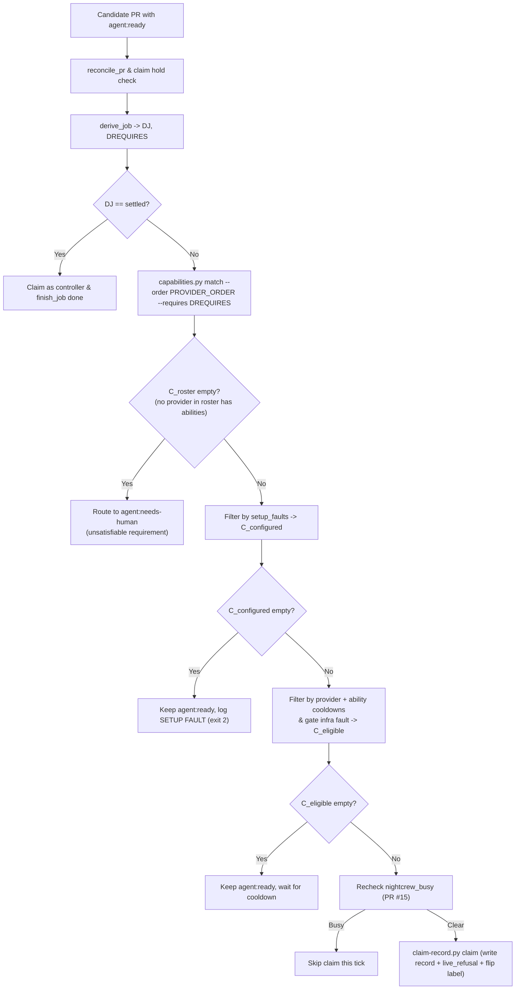

# Provider capability model

Status: design plan only. Written against `master` at `9a5b472` (which includes merged PRs #2, #11, #13, #15, and #17), open PR #19 (`scripts/tools/night_shift.sh`), `docs/plans/agent-pool-worker-pool.md`, and `docs/plans/controller-gates.md`.

## Context and motivation

Today `agent-pool/bin/prod-common.sh` models only two job kinds (`review` and `resolve`, plus `settled` which runs no provider) and hardcodes provider eligibility in `job_providers()` (`agent-pool/bin/prod-common.sh`, lines 231-240) with a single special case: `agy` is skipped for `resolve` unless `AGY_AUTO_APPROVE=1` is set. Meanwhile:

1. `docs/plans/controller-gates.md` moves gate execution out of workers into a controller-owned bubblewrap sandbox (`agent-pool/scripts/gates.py` reading `.agent-pool/gates.toml`), strips keys and ambient credentials from workers, and removes `agy` from `resolve` permanently because `--dangerously-skip-permissions` violates the no-keys invariant.
2. Open PR #19 adds `scripts/tools/night_shift.sh` so TheNightCrew can dispatch `cursor` on repository issues using `policy.py cursor-json --job resolve`, while noting that test execution inside the worker remains a temporary residual risk until controller-run gates land.
3. Different tasks require different trust boundaries and publication contracts: writing a design plan, reviewing a diff, building a throwaway prototype, authoring tests without touching production code, and resolving findings on a branch.

Borrowing the capability-and-requirement model from Atlassian Bamboo, each provider worker advertises a set of **abilities**, each queued job declares its **required abilities** (`requires`), and a worker only claims or falls back onto a job when its available abilities satisfy every requirement on the job.

---

## 1. Ability vocabulary

Every job processed by `agent-pool/bin/prod-common.sh` (and issue-dispatched jobs routed through `scripts/tools/night_shift.sh`) uses a closed vocabulary of five abilities. Under the **controller-commits-everything** rule (Section 7), no worker ever runs `git add`, `git commit`, `git push`, or any gate command.

| Ability | Worker read scope | Worker write scope | Controller gates run? | Controller commits and pushes? | Output artifact on Gitea |
|---|---|---|---|---|---|
| `plan` | Worktree files, `.agent-pool-context.md`, read-only git (`status`, `diff`, `log`, `show`) | Report file only (`$AGENT_POOL_STATE/runs/report-<tag>.md`) | No | No (worktree must remain clean) | Plan comment carrying `<!-- pulse-plan:v1 head=<sha> -->` |
| `review` | Same as `plan` | Report file only | No (optional pre-review gate context in `.agent-pool-context.md`) | No (worktree must remain clean) | Review comment carrying `<!-- pulse-review:v1 head=<sha> findings=<n> -->` |
| `prototype` | Same as `plan` | Worktree files (excluding protected and tool-config paths) plus report file | Optional (informational receipt only; red gate does not discard the prototype) | Commits to a local controller ref (`refs/agent-pool/prototypes/<pr>/<attempt_id>`); **never pushed** to `origin` unless promoted | Comment with diffstat, sanitized patch block, and `<!-- pulse-prototype:v1 base=<sha> commit=<proto_sha> files=<n> -->` |
| `test-author` | Same as `plan` | Test paths only (matched against `test_paths` in `.agent-pool/gates.toml`) plus report file | Yes, mandatory (`agent-pool/scripts/gates.py run` in sandbox) | Yes: controller creates a signed commit and fast-forward pushes `refs/heads/<headref>` if gates match expectation | Comment with gate section and `<!-- pulse-test-author:v1 head=<newhead> base=<sha> tests_changed=<n> -->` |
| `resolve` | Same as `plan` | Worktree files (excluding `.agent-pool/gates.toml`, lockfiles, `protect` list, and tool configs) plus report file | Yes, mandatory (`agent-pool/scripts/gates.py run` in sandbox) | Yes: controller creates a signed commit and fast-forward pushes `refs/heads/<headref>` only when gates pass | Comment with gate section and `<!-- pulse-resolve:v1 head=<newhead> reviewed=<rhead> fixed=<n> noted=<n> deferred=<n> -->` |

### Detailed semantics per ability

1. **`plan`**:
   - Produces an architectural or implementation plan for an issue or PR without altering repository files.
   - If the worker modifies any tracked or untracked file inside `$JOB_WT`, the controller discards the worktree changes and fails verification if the report is missing.
2. **`review`**:
   - Preserves the existing contract in `agent-pool/bin/prod-common.sh` and `skills/pr-loops-common/marker.py`.
   - Reads the PR diff, commit history, comments, and unresolved review threads from `.agent-pool-context.md` (`write_context()` in `agent-pool/bin/prod-common.sh`, lines 603-615) and read-only tools, then writes the review report.
3. **`prototype`**:
   - Executes in a detached throwaway worktree created by `prepare_worktree()` (`agent-pool/bin/prod-common.sh`, lines 593-599).
   - Gives the worker full worktree edit capability (subject to protected-file and secret checks) to explore a spike or alternative implementation.
   - The controller never pushes a `prototype` result to `origin/<headref>`. Instead, it records a signed commit under a local controller-only ref in `$AGENT_POOL_MAIN`, posts the sanitized diff and report to Gitea, and deletes the worktree in `end_job()`. Promotion to a real branch requires an explicit human action (`agent:promote`, Section 7).
4. **`test-author`**:
   - Separates test creation from implementation so one provider (including `agy`) can write unit or integration tests while the controller executes them in the bubblewrap sandbox defined in `docs/plans/controller-gates.md`.
   - The worker may only create or edit files matching the repository's `test_paths` globs (defaulting to `tests/**`, `**/tests/**`, `**/*.test.*`, `**/*.spec.*`, `*Test.cs`, `*Test.php`, and `**/verify-*.sh`, minus any path in `protect`). Touching any non-test path causes `publish()` to reject the run and transition to `agent:needs-human`.
5. **`resolve`**:
   - Addresses findings from the latest `pulse-review:v1` marker (or implements an approved issue spec when invoked via the issue executor flow).
   - The worker edits files in `$JOB_WT` and writes its disposition report. It does not stage, commit, run gates, or push; the controller runs gates, creates the signed commit with trailers, stamps the resulting commit SHA into the marker, and pushes through `claim-record.py guard`.

---

## 2. Per-provider capability manifest

Capabilities are defined in a new helper `agent-pool/scripts/capabilities.py` (backed by static defaults and optional per-host narrowing via `AGENT_POOL_ABILITIES_<PROVIDER>`). An operator env var can **narrow** a provider's advertised abilities (for example `AGENT_POOL_ABILITIES_GROK=review,plan`), but can never **widen** a provider beyond its hard ceiling in `capabilities.py` (in particular, `agy` can never be granted `resolve`).

### Capability matrix

| Provider | `plan` | `review` | `prototype` | `test-author` | `resolve` | Containment & invocation mechanism (`agent-pool/bin/prod-common.sh` & `agent-pool/scripts/policy.py`) |
|---|---|---|---|---|---|---|
| `claude` | Yes | Yes | Yes | Yes | Yes | `claude -p --output-format json --model <model> --permission-mode default`, scoped `--add-dir`, `--allowedTools` / `--disallowedTools`, PreToolUse hook (`policy.py hook-settings` -> `policy.py hook`), PATH `git` shim |
| `codex` | Yes | Yes | Yes | Yes | Yes | `codex exec --ephemeral --sandbox <mode> --model <model> --cd <wt> -` (`read-only` for `plan`/`review`; `workspace-write` for `prototype`/`test-author`/`resolve`); no network inside sandbox; stays out of default `PROVIDER_ORDER` unless listed |
| `cursor` | Yes | Yes | Yes | Yes | Yes | `cursor-agent -p --trust --workspace <wt> --output-format stream-json --model <model>` (never `--force`); per-worktree `.cursor/cli.json` (`policy.py cursor-json`), optional `.cursor/hooks.json`, PATH `git` shim |
| `grok` | Yes | Yes | Yes | Yes | Yes | `grok --cwd <wt> --prompt-file <prompt> --output-format json --permission-mode dontAsk -m <model>`, per-ability `--allow` and `--deny` rules from `policy.py`, PATH `git` shim |
| `agy` | Yes | Yes | Yes | Yes | **No** | `agy -p <prompt> --output-format json --print-timeout 0 --mode plan`; never uses `--dangerously-skip-permissions` |

### Why `agy` has `plan`, `review`, `prototype`, `test-author` and NO `resolve`

- **Why `resolve` is forbidden for `agy`**: In `agent-pool/bin/prod-common.sh` (lines 95, 237, 312), `agy` could previously take `resolve` jobs only when `AGY_AUTO_APPROVE=1` added `--dangerously-skip-permissions`. As Craig confirmed and `docs/plans/controller-gates.md` (Section 5) records, `--dangerously-skip-permissions` lets the worker run arbitrary shell commands without an allowlist or hook, breaking the no-keys / no-code-execution containment invariant. `AGY_AUTO_APPROVE` is retired (setting it logs a `SETUP FAULT` and exits 2), and `capabilities.py` hard-blocks `agy` from advertising `resolve`.
- **How `agy` executes `plan` and `review`**: `agy` runs in `--mode plan`, where all command execution and file writes are denied by the CLI itself. It reads `.agent-pool-context.md` (pre-populated by `write_context()` in `agent-pool/bin/prod-common.sh`) and emits its markdown report as the JSON `response` field (`agent-pool/scripts/classify.py`, line 175), which `classify.py` writes to `--result-out` for `publish()` to validate and post.
- **How `agy` executes `prototype` and `test-author` without `--dangerously-skip-permissions`**:
  - `agy` still runs in `--mode plan` (so it never executes shell commands and never needs `--dangerously-skip-permissions`).
  - Its prompt template (`prompts/prototype.agy.txt` and `prompts/test-author.agy.txt`) instructs it to emit its file additions/edits inside a fenced `patch` / unified-diff block (or file-replacement blocks) in its final response alongside its report marker, using the target files pre-included in `.agent-pool-context.md`.
  - After `agy` exits, a controller helper (`report.py extract-patch`) extracts the diff from `$result` and applies it to `$JOB_WT` via `gate_git apply --recount` (checking path containment and `test_paths` for `test-author`).
  - From that point on, the controller handles the worktree identically to any other provider: for `prototype`, it commits to the local prototype ref; for `test-author`, it runs `gates.py run` in the bubblewrap sandbox, creates the signed commit, and pushes if green.

### Per-ability permission translation in `agent-pool/scripts/policy.py`

With controller-run gates (`docs/plans/controller-gates.md`) and controller-created commits (Section 7), `policy.py` accepts `--job plan|review|prototype|test-author|resolve`:

- **`plan` and `review`**:
  - Allowed shell: `git status`, `git diff`, `git log`, `git show` with vetted flags in `GIT_SPECS` (`agent-pool/scripts/policy.py`, lines 95-102).
  - Allowed native tools: `Read`, `Grep`, `Glob` scoped to `read_roots()` (`$JOB_WT` and the per-job run directory), plus `Write(<report>)`.
  - Denied: all `Edit`/`Write` inside `$JOB_WT`, all `git add`/`git commit`/`git push`.
- **`test-author`**:
  - Everything in `review`, plus `Edit` and `Write` scoped specifically to the repo's `test_paths` globs inside `$JOB_WT` (enforced pre-execution in `policy.py`'s `write_allowed()` for Claude/Cursor hooks and allow-globs for Claude/Cursor/Grok, and post-execution by the controller's diff check in `publish()`).
- **`prototype` and `resolve`**:
  - Everything in `review`, plus `Edit` and `Write` on `$JOB_WT/**`, excluding `.git/**`, `TOOL_CONFIG` (`.cursor/`, `.grok/`, `.claude/`, `.agent-pool-context.md`), `.agent-pool/**`, and all `protect` / lockfile paths from `.agent-pool/gates.toml`.

---

## 3. How jobs declare requirements: `agent:*` labels plus a `requires` field

Jobs declare what abilities they need through two composable mechanisms: Gitea `agent:*` labels and an explicit `requires` list on the job/claim record.

### 3.1 Label vocabulary (`skills/pr-loops-common/gitea-labels.py`)

`gitea-labels.py` currently defines four pool state labels (`agent:ready`, `agent:claimed`, `agent:done`, `agent:needs-human`, lines 50-53). We keep those four state labels unchanged and add optional **ability requirement labels** plus one **promotion action label**:

| Label | Category | Meaning |
|---|---|---|
| `agent:ready` | Queue state | Queued for the agent pool to claim |
| `agent:claimed` | Queue state | An agent-pool worker holds a live claim on this PR/issue |
| `agent:done` | Queue state | The agent pool finished; marker on the head names the result |
| `agent:needs-human` | Queue state | Automation stopped and a human must inspect |
| `agent:plan` | Ability requirement | Job requires `["plan"]` |
| `agent:review` | Ability requirement | Job requires `["review"]` |
| `agent:prototype` | Ability requirement | Job requires `["prototype"]` |
| `agent:test-author` | Ability requirement | Job requires `["test-author"]` |
| `agent:resolve` | Ability requirement | Job requires `["resolve"]` |
| `agent:promote` | Controller action | Promote the latest verified `prototype` commit on this PR/issue into a pushed branch commit after gates pass |

`skills/pr-loops-common/pr-merge.sh` (lines 56-58, 95, 154, 174) is updated to treat `agent:plan`, `agent:review`, `agent:prototype`, `agent:test-author`, `agent:resolve`, and `agent:promote` as blocking while `agent:ready` or `agent:claimed` is present, and to strip any leftover ability labels alongside `agent:ready,agent:claimed,agent:done` when merging or failing a PR.

### 3.2 Deriving `requires` for a candidate job

A job's `requires` field is a sorted, deduplicated list of ability strings (`list[str]`). `derive_job()` in `agent-pool/bin/prod-common.sh` (lines 379-396) is extended to compute both `DJ` (the primary execution phase) and `DREQUIRES` (comma-separated required abilities) in priority order:

1. **Settled check first**: If the PR carries no unfulfilled ability override and already has a clean `pulse-review:v1` marker at `head_sha` or a verified `pulse-resolve:v1` marker answering the latest review at `head_sha` (with a passing gate receipt per `docs/plans/controller-gates.md`), `DJ=settled` and `DREQUIRES=""` (handled by `controller` without spawning a provider).
2. **Explicit `agent:<ability>` labels on the PR/issue**:
   - Any `agent:plan`, `agent:review`, `agent:prototype`, `agent:test-author`, or `agent:resolve` labels on the PR are collected into `requires`.
   - Multiple ability labels can be combined on a composite job (for example `agent:test-author` + `agent:resolve` means `requires = ["resolve", "test-author"]`: the claiming worker must advertise **both** abilities, or the job is executed as a staged pipeline where `test-author` runs first and strips `agent:test-author` on completion, leaving `agent:resolve` for the next pass; see Section 4.2).
3. **Structured directive in the PR/issue description or latest human comment**:
   - `<!-- agent-pool-job: requires=prototype -->` or `<!-- agent-pool-job: requires=test-author,resolve -->`.
   - Parsed by `agent-pool/scripts/capabilities.py parse-requires`, allowing issue templates or NightCrew dispatches to declare requirements without extra label round-trips.
4. **Default marker-based derivation (existing `derive_job()` behavior when no explicit ability label or directive is present)**:
   - Latest `pulse-review:v1` marker matches `head_sha` and `findings > 0` -> `DJ=resolve`, `requires=["resolve"]`.
   - Anything else -> `DJ=review`, `requires=["review"]`.

### 3.3 The `requires` field in the claim record (`agent-pool/scripts/claim-record.py`)

`new_record()` in `agent-pool/scripts/claim-record.py` (lines 119-130) adds `"requires"` to the v2 claim JSON under `$AGENT_POOL_STATE/claims/<repo>__<pr>.json`:

```json
{
  "version": 2,
  "repo_slug": "craigpars/AgileMedievalPeasantBoard",
  "issue_number": 42,
  "provider": "claude",
  "worker_id": "host-pool",
  "attempt_id": "<uuid4>",
  "branch": "feature/example",
  "worktree": "<worktree-path>",
  "job": "resolve",
  "requires": ["resolve"],
  "claimed_at": "2026-10-20T14:00:00Z",
  "expected_deadline_at": "2026-10-20T14:55:00Z"
}
```

`claim-record.py claim` accepts `--requires <csv>` (defaulting to `--job` when omitted so existing callers in `agent-pool/tests/verify-lease.sh` remain compatible) and preserves `requires` across `reattempt` calls (`cmd_reattempt()`, lines 190-197).

---

## 4. Claim filtering by ability alongside leases, fencing and cooldowns

### 4.1 End-to-end claim filter pipeline

During a tick of `agent-pool/bin/prod-common.sh`, provider selection and claim acquisition combine ability matching with the existing lease, fencing, NightCrew hold, and cooldown rules:



### 4.2 Matching rule and composite requirements

`agent-pool/scripts/capabilities.py` implements the Bamboo capability check:

- For a single-ability job (`requires = ["resolve"]`), a provider `p` matches if `"resolve" in abilities(p)`. Thus for `requires = ["resolve"]`, `claude`, `cursor`, `grok`, and `codex` match; `agy` does not.
- For a multi-ability job (`requires = ["test-author", "resolve"]`), `capabilities.py` checks `set(requires) <= set(abilities(p))`. Because `agy` lacks `resolve`, `agy` cannot claim a combined `["test-author", "resolve"]` job in one attempt. However, if a workflow labels the PR `agent:test-author` first, `agy` can claim and complete the `test-author` job; once the tests are committed and reviewed, the follow-up `resolve` job requires only `["resolve"]` and is claimed by `claude`, `cursor`, `grok`, or `codex`.

### 4.3 Interaction with leases, `live_refusal`, `reattempt`, and fencing

1. **Pre-claim capability check**:
   - `job_providers()` in `agent-pool/bin/prod-common.sh` (lines 231-240) is replaced by `capable_providers "$DJ" "$DREQUIRES"`.
   - `capable_providers` filters `PROVIDERS` (already vetted by `select_providers()` for binary, model, and provider-level cooldown) through:
     - `capabilities.py match --provider "$p" --requires "$DREQUIRES"`
     - `cooldown.py active --provider "$p" --ability "$ab"` for each `ab` in `DREQUIRES`
     - Prompt template existence check (`prompt_for "$p" "$DJ"`) moved from startup `select_providers()` to `capable_providers()`, so a provider that does not support `resolve` (like `agy`) is never faulted for lacking a `resolve` prompt template.
     - Gate infrastructure check: if `DREQUIRES` contains `resolve` or `test-author` and `$AGENT_POOL_STATE/faults/gates.json` is active (per `docs/plans/controller-gates.md` Section 3), `capable_providers` returns empty so gate-dependent jobs are not claimed while `plan`, `review`, and `prototype` jobs continue running.
2. **Atomic claim under the job lock (`agent-pool/scripts/claim-record.py`)**:
   - `claim-record.py claim` acquires `poolstate.locked(path)` on `$AGENT_POOL_STATE/claims/<repo>__<pr>.json.lock`.
   - `live_refusal()` (`claim-record.py`, lines 148-166) re-reads `gitea-pr.py state` live under the lock and additionally verifies `--expect-ability-labels`: if a human added or removed an `agent:<ability>` label since the candidate listing was taken at the start of the tick, `live_refusal()` returns exit 6 (`the live PR state no longer allows the claim`) so the worker never runs with a stale `requires` set.
   - `claim-record.py claim` also validates that `--provider` satisfies `--requires` via `capabilities.py` before writing the claim file, closing any race or misconfiguration in caller scripts.
3. **In-job provider fallback (`reattempt`) and fencing**:
   - In `run_job()` (`agent-pool/bin/prod-common.sh`, lines 714-746), the loop iterates only over `JOB_PROVIDERS` (the providers in `C_eligible` that satisfy `DREQUIRES`).
   - When the first provider hits a `limit`, `timeout`, or `setup` fault and `run_job()` falls back to the next provider `p` via `claim-record.py reattempt --attempt "$ATTEMPT" --provider "$p"`, `reattempt` checks:
     1. `$ATTEMPT` is still the current attempt on disk (exit 4 if superseded by `doctor.sh` or another tick).
     2. The new provider `p` satisfies the claim record's `requires` list.
   - `reattempt` atomically writes a new `attempt_id` and fresh `expected_deadline_at`, fencing off any late process or trap from the previous provider via `watch_start()`, `still_held()`, `claim-record.py guard`, and `claim-record.py release`.

---

## 5. Doctor handling of jobs no available provider can satisfy (`needs-human` vs wait for cooldown)

A pull-based worker pool where workers only claim what they can satisfy introduces a classic scheduling hazard: **starvation of jobs whose requirements no available worker can meet**. If `PROVIDER_ORDER=agy` and a PR needs `resolve`, every `agy` tick will skip the PR forever unless the pool distinguishes *permanent capability mismatch* from *temporary cooldown unavailability*.

Both `agent-pool/bin/prod-common.sh` (during normal ticks) and `agent-pool/bin/doctor.sh` (on its 5-minute non-LLM timer from `docs/plans/agent-pool-worker-pool.md`) evaluate unsatisfiable `agent:ready` jobs using a deterministic three-tier partition of the configured roster (`PROVIDER_ORDER`):

- **`C_roster`**: providers listed in `PROVIDER_ORDER` whose capability manifest (`capabilities.py`) satisfies `job.requires`.
- **`C_configured`**: providers in `C_roster` that pass binary, model, and prompt preflight without a `SETUP FAULT`.
- **`C_eligible`**: providers in `C_configured` that are not in an active provider-level cooldown, not in an active ability-level cooldown for any ability in `job.requires`, and not blocked by an active `faults/gates.json` infra fault.

### Decision table for an `agent:ready` job with `C_eligible == empty`

| Condition | Meaning | Action by `prod-common.sh` / `doctor.sh` | Gitea label transition | Cooldown / fault effect |
|---|---|---|---|---|
| `C_roster` is empty | **Unsatisfiable by roster.** No provider in `PROVIDER_ORDER` advertises `job.requires` (e.g., job requires `resolve` when `PROVIDER_ORDER=agy`, or requires an ability combination no single provider has). | Claim briefly as `controller`, post a diagnostic comment naming `job.requires` and the capabilities of `PROVIDER_ORDER`, and release to `agent:needs-human`. | `agent:ready` -> `agent:needs-human` | None (not a provider fault). |
| `C_roster` non-empty, `C_configured` is empty | **Host setup fault on all capable providers.** A capable provider is in `PROVIDER_ORDER`, but its binary is missing, its model env var is unset, or `faults/<provider>.json` is active. | Do **not** blame the PR. Leave the PR in `agent:ready`, log `SETUP FAULT`, and exit 2 so systemd / operator monitoring alerts. | Stays `agent:ready` | `cooldown.py fault` recorded per broken provider; tick exits 2. |
| `C_configured` non-empty, `C_eligible` is empty due to `faults/gates.json` | **Gate sandbox infra broken.** Capable providers exist for `resolve`/`test-author`, but controller gate sandbox failed on an earlier tick (`docs/plans/controller-gates.md` Section 3). | Leave the PR in `agent:ready`; log that gate-dependent abilities are paused until `faults/gates.json` clears. `plan`/`review`/`prototype` jobs still run. | Stays `agent:ready` | `faults/gates.json` remains active; tick exits 2. |
| `C_configured` non-empty, `C_eligible` is empty due to active cooldowns | **Temporary cooldown.** At least one configured provider can satisfy `job.requires`, but all such providers are currently cooling down (provider-level or ability-level). | **Wait for cooldown.** Touch nothing on Gitea; log the earliest `until` timestamp across `C_configured` (`waiting for cooldown; earliest eligible provider <p> in <Nm>`). | Stays `agent:ready` | Existing cooldowns tick down naturally. |

### How `doctor.sh` handles stale claims alongside capabilities

When `agent-pool/bin/doctor.sh` runs its 5-minute tick (`docs/plans/agent-pool-worker-pool.md`):

1. **Step 1 (Reconcile claimed jobs)**: For every open PR carrying `agent:claimed` or a claim file under `$AGENT_POOL_STATE/claims/`, `doctor.sh` runs `claim-record.py reconcile`. If a claim is `stale` (`now > expected_deadline_at` and no `.published` mark exists):
   - It records a cooldown for the timed-out claim's `(provider, job)` pair via `cooldown.py record --provider <prov> --ability <job>`.
   - It writes the durable reassignment notice to `$AGENT_POOL_STATE/mailboxes/<worker_id>/<message_id>.json` via `mailbox.py` and stops any active `prod-<provider>.service` unit.
   - It calls `claim-record.py requeue` to flip `agent:claimed` -> `agent:ready` and delete the claim file.
2. **Step 2 (Sweep `agent:ready` queue for unsatisfiable requirements)**:
   - For each open `agent:ready` PR not held by a human or NightCrew, `doctor.sh` derives `requires` and runs `capabilities.py check-queue --order "$PROVIDER_ORDER" --requires "$DREQUIRES"`.
   - If `C_roster` is empty, `doctor.sh` (when `DOCTOR_DRY_RUN=0` and the repo is in the doctor's allowlist) transitions the PR from `agent:ready` to `agent:needs-human` with the explanation:
     `Automated pool stopped on this PR: job requires ability [<requires>], which no configured provider in PROVIDER_ORDER (<order>) advertises.`
   - If `C_roster` is non-empty and `C_eligible` is empty because of cooldowns, `doctor.sh` logs `WAIT_COOLDOWN` with the remaining seconds until the next capable provider wakes up, and leaves `agent:ready` untouched.

---

## 6. Ability-level vs provider-level cooldowns

Today `agent-pool/scripts/cooldown.py` stores one file per provider at `$AGENT_POOL_STATE/cooldowns/<provider>.json` with a single `until` and `strikes` counter. Every cooldown blocks the provider across all job types. With five abilities of very different weight and failure modes, `cooldown.py` is extended to track **both** provider-level and ability-level cooldowns in the same atomic document.

### 6.1 When a cooldown is provider-level vs ability-level

| Failure source | Scope | Strike behavior | Why |
|---|---|---|---|
| Account credit wall (`Credit balance is too low`, `insufficient credits`, `purchase more credits` in `classify.py`) | **Provider-level** | Exponential backoff strike (`base * 2^(strikes-1)`, 1h to 24h cap) | Account has no funds; every ability (`plan`, `review`, `resolve`) on this provider will fail the same way. |
| Account-wide HTTP 429 / quota exhausted (`ANY_LIMIT` / `PRODUCT_LIMIT` in `classify.py`) | **Provider-level** (default) or **Ability-level** (when `AGENT_POOL_MODEL_<PROVIDER>_<ABILITY>` differs from the provider default) | Exponential backoff strike | If all abilities share one model and quota pool, the whole provider is rate-limited. If `resolve` uses a dedicated model tier with a separate quota from `review`, only abilities sharing that model cool down. |
| Fast-fail with no marker (`elapsed < AGENT_POOL_FAST_FAIL_SECS` and `fail-nomarker` in `prod-common.sh` line 676) | **Provider-level** | Exponential backoff strike | Matches the 32-second credit-wall / silent account rejection signature. |
| Worker timeout (`rc` 124/137 in `classify.py` or `WORKER_TIMEOUT` reached in `prod-common.sh` line 738) | **Ability-level** (`--ability <job>`) | Fixed pause (`AGENT_POOL_TIMEOUT_COOLDOWN=900`, no strike) | A provider that timed out on a 20-minute `resolve` or `prototype` can still complete a 2-minute `review` or `plan` while paused for `resolve`. |
| Stale claim reaped by `reconcile_pr()` or `doctor.sh` (`now > expected_deadline_at` with no `.published` mark) | **Ability-level** (`--ability <job>`) on first occurrence; escalates to **Provider-level** if 2 consecutive abilities go stale | Strike on the ability; provider strike if repeated across abilities | A silent hang on a heavy `resolve` pauses `resolve` first; if the provider also hangs on `review`, the provider daemon/CLI itself is wedged. |
| Repeated ability output-contract failure (e.g. `agy` in `prototype` or `test-author` failing patch extraction twice in a row) | **Ability-level** (`--ability <job>`) | Fixed pause (`AGENT_POOL_TIMEOUT_COOLDOWN`) | Stops a provider from burning ticks on an ability whose structured output format it is struggling with, while keeping its `review` and `plan` abilities active. |
| Setup fault (`classify.py` returns `setup`, tool denial, missing binary/model) | **Fault record** (`faults/<provider>.json` or `faults/<provider>__<ability>.json`) | No cooldown; logs `SETUP FAULT` and exits 2 | Per `cooldown.py` lines 9-12, setup faults must be fixed by an operator, except that an ability-specific setup fault (such as a missing `prompts/prototype.<provider>.txt`) only blocks that ability while other abilities remain runnable. |

### 6.2 Schema and CLI changes in `agent-pool/scripts/cooldown.py`

`$AGENT_POOL_STATE/cooldowns/<provider>.json` keeps its top-level provider fields (backward-compatible with existing tests in `agent-pool/tests/verify-lease.sh`) and adds an `"abilities"` map:

```json
{
  "provider": "claude",
  "strikes": 0,
  "since": 0,
  "until": 0,
  "seconds": 0,
  "reason": "",
  "abilities": {
    "resolve": {
      "strikes": 1,
      "since": 1792500000,
      "until": 1792500900,
      "seconds": 900,
      "reason": "claude hit the worker timeout (exit 124) after 1800s"
    }
  }
}
```

Subcommand behavior in `agent-pool/scripts/cooldown.py`:

- `cooldown.py record --provider P --reason R [--seconds S] [--ability A]`:
  - Without `--ability`: updates top-level `strikes` and `until` (provider-level cooldown).
  - With `--ability A`: updates `doc["abilities"][A]` using the same strike and lapse formula (`now - until > cap()` resets strikes to 0; `--seconds S` sets a fixed pause with no strike).
- `cooldown.py active --provider P [--ability A]`:
  - Computes `rem = remaining_provider(doc, now)`.
  - If `--ability A` is passed, `rem = max(rem, remaining_ability(doc, A, now))`.
  - Prints remaining seconds and exits 0 if `rem > 0`, else exits 1.
- `cooldown.py eligible --order a,b,c [--ability A[,B...]]`:
  - Returns providers in `--order` where top-level `remaining <= 0` AND, for every ability in `--ability`, `remaining_ability <= 0`.
- `cooldown.py clear --provider P [--ability A]`:
  - A verified completion on ability `A` clears `doc["abilities"][A]` strikes **and** clears top-level provider strikes (since any verified completion proves the provider's credentials and billing are working).

---

## 7. Publishing `plan`, `prototype` and `test-author` outputs under controller-commits-everything

### 7.1 Controller-commits-everything architecture

In `docs/plans/controller-gates.md` (Section 4 and Section 7, Question 1), workers still ran `git add <named paths>` and `git commit -m <msg>` during `resolve` so the worker knew the commit SHA for its marker. Under this capability plan, **all commits are moved to the controller**:

1. **Worker permissions (`agent-pool/scripts/policy.py`)**:
   - `COMMIT_SHELL` (`git add *`, `git commit -m *`) and the `sub in ("add", "commit")` branches in `segment_ok()` (`agent-pool/scripts/policy.py`, lines 293-300, 337) are deleted.
   - Every provider worker has the exact same read-only git command set (`git status`, `git diff`, `git log`, `git show`), enforced by CLI rules, hooks, and the `workerbin/git` PATH shim.
   - Workers never write to `.git` or the git index.
2. **Creating signed commits with trailers in `agent-pool/bin/prod-common.sh`**:
   - New controller function `controller_commit()` runs after the worker process group is killed (`kill_worker_group`) and `still_held` is verified.
   - Using `gate_git` (the scrubbed git wrapper from `docs/plans/controller-gates.md` Section 2.2) and a temporary index file `$RUNS/index-$JOB_PR-${ATTEMPT:0:8}` initialized from `$sha`:
     1. The controller inspects modified and untracked files inside `$JOB_WT` via `gate_git --work-tree="$JOB_WT" status --porcelain -z`, ignoring excluded tool config paths (`.cursor/`, `.grok/`, `.claude/`, `.agent-pool-context.md`, `.agent-pool/`).
     2. It verifies no changed path matches the protected set (`gates.py protected`) or credential filename patterns (`AGENTS.md`).
     3. For `test-author`, it verifies every changed path matches `test_paths` from `.agent-pool/gates.toml`.
     4. It stages the validated paths into the private index (`GIT_INDEX_FILE="$idx" gate_git --work-tree="$JOB_WT" add -- <paths>`), writes a tree object (`gate_git write-tree`), and runs `report.py scan` on the unified diff between `$sha` and the new tree.
     5. For gated abilities (`resolve` and `test-author`), it checks out the candidate tree into `$GATE_DIR` and runs `gates.py run` (`docs/plans/controller-gates.md` Section 2). If gates fail, no commit ref is updated and nothing is pushed.
     6. It builds the commit message from the report's summary line (or `chore(<ability>): automated <ability> for #<pr>`) followed by mandatory structured trailers:
        ```text
        <summary line from report>

        Agent-Pool-Provider: <provider>
        Agent-Pool-Ability: <ability>
        Agent-Pool-Worker: <worker_id>
        Agent-Pool-Attempt: <attempt_id>
        Agent-Pool-Model: <model_or_default>
        ```
     7. It creates a **signed commit** in `$MAIN` using the controller's signing configuration (`AGENT_POOL_GIT_SIGNING_KEY` / controller `~/.gitconfig` signing keys, which exist only in the controller's own environment and were stripped from `spawn_worker` and `bwrap`):
        ```bash
        newhead="$(gate_git_signed commit-tree "$tree_sha" -p "$sha" -S -F "$msg_file")"
        ```
        Because `commit-tree` operates purely on `$MAIN`'s object database and the private index, it never executes worktree hooks or reads `.git/config` inside `$JOB_WT`.
3. **Marker head stamping (`agent-pool/scripts/report.py` and `skills/pr-loops-common/marker.py`)**:
   - Because the worker exits before the controller creates the signed commit, the worker writes `head=pending` (or `head=<sha>` when `fixed=0`) in its `pulse-resolve:v1` or `pulse-test-author:v1` marker.
   - `report.py` validates the marker structure (`reviewed=`, `fixed + noted + deferred == findings`, secret scan) with `head=pending` before commit creation, and a new subcommand `report.py stamp-head --file "$report" --head "$newhead"` rewrites `head=pending` to `head=$newhead` right after `controller_commit()` succeeds and before `comment_file()` posts the report.
   - `skills/pr-loops-common/marker.py` remains unchanged: the comment posted to Gitea always carries the final 40-hex `head=<newhead>` SHA, so `verify()` in `prod-common.sh` and `skills/pr-loops-common/pr-merge.sh` work without modification.

### 7.2 Publication flow per ability

#### A. Publishing `plan` outputs
1. **Worktree check**: `publish()` checks that `$JOB_WT` has no tracked edits (`gate_git --work-tree="$JOB_WT" diff --quiet "$sha"`). Any stray edits are discarded and not committed.
2. **Report validation**: `report.py plan --file "$report" --sha "$sha"` checks that the report is non-empty, passes `leaks_secret()` and host-path sanitization (`report.py sanitize`), and ends with:
   `<!-- pulse-plan:v1 head=<40-hex-sha> -->`
3. **Publication**: `comment_file "$report"` posts the plan comment to the PR/issue through `claim-record.py guard --attempt "$ATTEMPT"`.
4. **Release**: `release_to "$DONE"` strips `agent:claimed` (and `agent:plan` if present) and applies `agent:done`. No git commit or push occurs.

#### B. Publishing `prototype` outputs (throwaway worktree, never pushed unless promoted)
1. **Patch extraction (for `agy` in `--mode plan`) or worktree inspection (for edit-capable providers)**:
   - If the provider is `agy`, `report.py extract-patch --file "$result"` extracts the unified diff and applies it to `$JOB_WT` with `gate_git apply`.
   - `controller_commit()` stages the worktree changes into a private index, scans for secrets and protected tool-config paths, and creates a signed commit `proto_sha` with trailers (`Agent-Pool-Ability: prototype`, `Agent-Pool-Provider: <provider>`, etc.).
2. **Local controller ref, never pushed**:
   - The controller stores `proto_sha` under a local ref in `$MAIN`:
     `refs/agent-pool/prototypes/$JOB_PR/$ATTEMPT`
   - It **never** pushes `proto_sha` to `origin`. The throwaway worktree `$JOB_WT` is deleted in `end_job()`.
   - Optional informational gates: if `.agent-pool/gates.toml` exists, the controller can run `gates.py run` on `proto_sha` and include the gate table in the comment, but a red gate does **not** suppress posting the prototype comment.
3. **Comment content**:
   - The controller appends a `### Prototype artifact (not pushed)` section to the worker's report containing:
     - `git diff --stat "$sha" "$proto_sha"`
     - A collapsible `<details>` block with the sanitized unified diff (`git diff "$sha" "$proto_sha"` passed through `report.py sanitize`, capped at 64 KiB) so a human can inspect or `git apply` it directly from Gitea.
     - Instructions to promote: add label `agent:promote` + `agent:ready` to fast-forward push this prototype to the PR branch.
     - The marker: `<!-- pulse-prototype:v1 base=<sha> commit=<proto_sha> attempt=<attempt_id> files=<n> -->`
4. **Promotion flow (`agent:promote`)**:
   - When a human labels the PR `agent:promote` and `agent:ready`, `derive_job()` detects `agent:promote`, resolves `proto_sha` from the latest `pulse-prototype:v1` marker (`refs/agent-pool/prototypes/$JOB_PR/$attempt`), verifies `sha` is an ancestor of `proto_sha` and matches the live PR head, runs mandatory controller gates (`gates.py run`) on `proto_sha` if not already passed, pushes `proto_sha:refs/heads/$headref` through `claim-record.py guard`, posts a promotion confirmation comment, and releases to `agent:done` (stripping `agent:promote`).

#### C. Publishing `test-author` outputs (worker writes tests; controller runs them, commits, and pushes)
1. **Path scope verification**:
   - `controller_commit()` lists all changed files between `$sha` and `$JOB_WT` (`diff --name-only -z`).
   - If no files changed, `PUB="fail:test-author worker wrote no test changes"`.
   - Every changed file is checked against `gates.py test-paths --manifest "$MANIFEST"` (which matches `test_paths` globs from `.agent-pool/gates.toml` and rejects anything in `protect`, `.agent-pool/**`, lockfiles, or production source paths). Any violation aborts before gates run with `PUB="fail:test-author touched non-test paths (<paths>)"` -> `agent:needs-human`.
2. **Controller gate execution**:
   - The controller materializes the tree into `$GATE_DIR` (`docs/plans/controller-gates.md` Section 2.1) and runs `gates.py run` inside the network-isolated bubblewrap sandbox.
   - By default, all selected gates must exit 0 (`result=pass`). If a gate fails, nothing is pushed and the PR transitions to `agent:needs-human` with the sanitized gate log tail (`docs/plans/controller-gates.md` Section 3).
3. **Signed commit and guarded push**:
   - On gate pass, `controller_commit()` writes the signed commit `newhead` carrying `Agent-Pool-Ability: test-author` and provider/worker/attempt trailers, and writes the gate receipt to `$AGENT_POOL_STATE/gates/by-head/<slug>__<pr>__<newhead>.json`.
   - `report.py stamp-head` stamps `head=$newhead` into `<!-- pulse-test-author:v1 head=<newhead> base=<sha> tests_changed=<n> -->`.
   - The controller verifies `ls-remote origin refs/heads/$headref == $sha`, pushes `$newhead:refs/heads/$headref` via `guarded "push"`, and posts the report + controller gate section via `comment_file`.
4. **Handoff**:
   - If the PR carried only `agent:test-author`, `release_to "$DONE"` transitions to `agent:done` (stripping `agent:test-author`).
   - If the PR also carried `agent:resolve` (staged test-then-resolve workflow), the controller strips `agent:test-author` and releases back to `agent:ready` so the next tick claims the `resolve` phase on top of the newly pushed test commit.

---

## 8. Migration order after the controller-gates follow-up and PR #19

Every step keeps all existing offline suites green (`agent-pool/tests/verify-lease.sh`, `agent-pool/tests/verify-providers.sh`, `agent-pool/tests/verify-nightcrew-issue-hold.sh`, `skills/pr-loops-common/tests/verify-merge.sh`, `skills/pr-loops-common/tests/verify-resolve.sh`, `skills/pr-loops-common/tests/verify-trigger.sh`, and `tests/verify-install.sh`).

### Step 0: Land PR #19 and the `controller-gates` follow-up first
1. Review and merge open PR #19 (`scripts/tools/night_shift.sh`, `scripts/tools/night_shift_maintenance.sh`, `scripts/tools/night_shift_gitea.py`, `scripts/tools/tests/verify-night-shift.sh`) via `skills/pr-loops-common/pr-merge.sh`.
2. Land the `controller-gates` PR (`docs/plans/controller-gates.md` Steps 1-10): `agent-pool/scripts/gates.py`, `.agent-pool/gates.toml`, `gate_git`, bubblewrap gate runner, shrunk `agent-pool/scripts/policy.py`, `workerbin/git` PATH shim, `agy` removed from `resolve`, and `AGY_AUTO_APPROVE` retired.
3. Update `scripts/tools/night_shift.sh` (from PR #19) to drop the temporary `python3 -m unittest`, `python3 -m behave`, and `bash <dir>/verify-*.sh` allowances from Cursor's `.cursor/cli.json` and run `agent-pool/scripts/gates.py run` from the launcher after `cursor-agent` exits (closing PR #19's documented residual risk).

### Step 1: Controller-commits-everything and signed commit trailers
- **Files**: `agent-pool/bin/prod-common.sh`, `agent-pool/scripts/policy.py`, `agent-pool/scripts/report.py`, `skills/pr-loops-common/prompts/resolve.generic.txt`, `scripts/tools/night_shift.sh`.
- Add `controller_commit()` in `agent-pool/bin/prod-common.sh` using a private index, `commit-tree -S`, and the `Agent-Pool-Provider`, `Agent-Pool-Ability`, `Agent-Pool-Worker`, `Agent-Pool-Attempt`, and `Agent-Pool-Model` trailers.
- Add `report.py stamp-head` and allow `head=pending` in pre-commit worker reports.
- Remove `git add` and `git commit` (`COMMIT_SHELL` and the `add`/`commit` branches of `segment_ok`) from `agent-pool/scripts/policy.py`.
- Invert the `git add` and `git commit` allow tests in `agent-pool/tests/verify-lease.sh` and `agent-pool/tests/verify-providers.sh` so worker-side `git add` and `git commit` are asserted as `deny`, and verify that `prod-common.sh` produces signed commits with trailers on `resolve`.

### Step 2: Capability manifest and requirement parser
- **Files**: new `agent-pool/scripts/capabilities.py`, `skills/pr-loops-common/gitea-labels.py`, `skills/pr-loops-common/pr-merge.sh`, `skills/pr-loops-common/marker.py`.
- Implement `agent-pool/scripts/capabilities.py` with subcommands:
  - `abilities --provider P`: prints the effective abilities for `P` (baseline manifest intersected with `AGENT_POOL_ABILITIES_<P>`, never widening past the baseline ceiling).
  - `match --order CSV --requires CSV`: prints providers in `order` whose abilities are a superset of `requires`.
  - `parse-requires --labels JSON [--body FILE] --default-job J`: outputs the canonical `requires` CSV.
- Add `agent:plan`, `agent:review`, `agent:prototype`, `agent:test-author`, `agent:resolve`, and `agent:promote` to `LABELS` in `skills/pr-loops-common/gitea-labels.py` and update the blocking/cleanup label sets in `skills/pr-loops-common/pr-merge.sh`.
- Add `pulse-plan:v1`, `pulse-prototype:v1`, and `pulse-test-author:v1` marker parsers in `skills/pr-loops-common/marker.py` and `agent-pool/scripts/report.py`.
- Add unit tests in `agent-pool/tests/verify-lease.sh` and `skills/pr-loops-common/tests/verify-merge.sh`.

### Step 3: Ability-level cooldowns in `agent-pool/scripts/cooldown.py`
- **Files**: `agent-pool/scripts/cooldown.py`, `agent-pool/tests/verify-lease.sh`.
- Add `--ability` support to `record`, `clear`, `active`, `eligible`, `fault`, and `show` in `agent-pool/scripts/cooldown.py`.
- Assert in `agent-pool/tests/verify-lease.sh` that:
  - An ability-level cooldown on `(claude, resolve)` blocks `eligible --order claude --ability resolve` while `eligible --order claude --ability review` still returns `claude`.
  - A provider-level cooldown on `claude` blocks all abilities.
  - `clear --provider claude --ability resolve` clears both the `resolve` ability cooldown and any top-level provider strikes.

### Step 4: Claim filtering by ability and unsatisfiable-job handling in `prod-common.sh` and `doctor.sh`
- **Files**: `agent-pool/scripts/claim-record.py`, `agent-pool/bin/prod-common.sh`, new `agent-pool/bin/doctor.sh`, `agent-pool/tests/verify-providers.sh`, new `agent-pool/tests/inject-staleness.sh`.
- Add `--requires` and `--expect-ability-labels` to `agent-pool/scripts/claim-record.py`.
- Replace `job_providers()` in `agent-pool/bin/prod-common.sh` with `capable_providers()`, implementing the `C_roster` / `C_configured` / `C_eligible` partition:
  - `C_roster` empty -> transition `agent:ready` to `agent:needs-human` with comment.
  - `C_configured` empty -> `SETUP FAULT`, keep `agent:ready`, exit 2.
  - `C_eligible` empty -> wait for cooldown, keep `agent:ready`, exit 0.
- Wire the same check into `agent-pool/bin/doctor.sh` alongside stale-claim reconciliation and mailbox enqueueing.
- Add end-to-end cases in `agent-pool/tests/verify-providers.sh`:
  - `PROVIDER_ORDER=agy` on a PR requiring `resolve` transitions immediately to `agent:needs-human`.
  - `PROVIDER_ORDER=claude` where `claude` is on a `resolve` ability cooldown leaves a `resolve` PR in `agent:ready` (waiting for cooldown) while still claiming and completing a `review` PR in the same tick.

### Step 5: `plan`, `prototype`, and `test-author` execution, prompts, and publication
- **Files**: `agent-pool/bin/prod-common.sh`, `agent-pool/scripts/policy.py`, `agent-pool/scripts/report.py`, `agent-pool/scripts/gates.py`, `skills/pr-loops-common/prompts/`.
- Add prompt templates `plan.generic.txt`, `prototype.generic.txt`, `prototype.agy.txt`, `test-author.generic.txt`, and `test-author.agy.txt` under `skills/pr-loops-common/prompts/`.
- Add `test_paths` validation to `agent-pool/scripts/gates.py` and `agent-pool/scripts/policy.py`.
- Add `report.py extract-patch` so `agy` can produce `prototype` and `test-author` changes in `--mode plan` without `--dangerously-skip-permissions`.
- Add `publish()` branches in `agent-pool/bin/prod-common.sh` for `plan`, `prototype` (saving to `refs/agent-pool/prototypes/<pr>/<attempt>` and never pushing), `agent:promote` (gating and pushing a promoted prototype), and `test-author` (enforcing test-only diff + controller gates + signed commit + guarded push).
- Add offline end-to-end tests in `agent-pool/tests/verify-providers.sh` covering all five abilities across all five providers (`claude`, `codex`, `cursor`, `grok`, `agy`).

---

## 9. Open questions for Craig

1. **How should `agy` produce file edits in `prototype` and `test-author` without `--dangerously-skip-permissions`?** This plan runs `agy` in `--mode plan` (where `agy` cannot execute shell commands or write files directly) and has the controller extract unified diffs from `agy`'s JSON response and apply them with `gate_git apply`. Does `agy` have a native flags-based write-only-to-workspace mode with shell execution disabled that you prefer over controller-applied patch extraction, or is `--mode plan` + controller `git apply` the right shape?
2. **In `test-author`, should a newly authored test be required to pass (`result=pass`) or fail (`expect_fail` red-first TDD) before the controller pushes it?** When `test-author` writes regression coverage for already-merged or already-fixed code, gates should pass. When `test-author` runs *before* `resolve` to reproduce a bug or review finding, a true reproducer test will fail until `resolve` fixes the production code. Should `agent:test-author` default to requiring green gates, with an optional directive `<!-- agent-pool-job: requires=test-author test-mode=red -->` that requires the new test to fail cleanly at the current head before handing off to `resolve`?
3. **Should composite requirements (`requires=test-author,resolve`) run as two separate controller-committed stages or one single-worker attempt?** Running them as two stages (Worker 1 claims `test-author`, controller runs gates and commits the tests; Worker 2 claims `resolve`, sees the committed tests, edits production code, and controller runs gates and commits the fix) lets `agy` take Stage 1 (`test-author`) and `claude`/`cursor`/`grok` take Stage 2 (`resolve`), and prevents the resolver from weakening the test it just wrote because `protect` can lock the test files during Stage 2. Do you want two-stage chaining as the default whenever both `agent:test-author` and `agent:resolve` labels are present?
4. **How should the controller sign commits (`controller_commit()`)?** Should `gate_git_signed` use an SSH signing key (`gpg.format=ssh` with a dedicated controller-only key file outside `$SSH_AUTH_SOCK`), a GPG key in a controller-only keyring (`GNUPGHOME`), or unsigned commits with the `Agent-Pool-*` trailers when no signing key is configured (`AGENT_POOL_GIT_SIGN=optional` vs `required`)?
5. **Single-commit vs per-finding commits under controller-commits-everything:** Once `git add` and `git commit` are removed from worker permissions, the controller commits the worker's final worktree tree as one signed commit per ability run (carrying the `Agent-Pool-*` trailers and per-finding dispositions in the commit body and PR comment). Is one controller-signed commit per run acceptable, or do you want workers to leave a structured `.agent-pool-commits.json` manifest of path-groups and messages for the controller to replay as multiple signed commits?
6. **Prototype retention and garbage collection:** `prototype` runs store their signed commits under `refs/agent-pool/prototypes/<pr>/<attempt_id>` in `$AGENT_POOL_MAIN` without pushing to `origin`. Should `agent-pool/bin/doctor.sh` prune unpromoted prototype refs once a PR is closed/merged or after a fixed TTL (for example 14 days)?
7. **Timeout before escalating an unsatisfiable `C_roster == empty` job to `agent:needs-human`:** If each provider has its own systemd timer (`prod-claude.timer`, `prod-agy.timer`) and its own per-service `PROVIDER_ORDER` override (for example `prod-agy.service` sets `PROVIDER_ORDER=agy` while `prod-claude.service` sets `PROVIDER_ORDER=claude`), an `agy` tick seeing a `resolve` job would think `C_roster` is empty if it only looked at its own `PROVIDER_ORDER`. Should `capabilities.py` check a host-wide `AGENT_POOL_ROSTER` (all providers enabled on the host across timers) before declaring a job unsatisfiable and moving it to `agent:needs-human`, while each individual timer still filters claims by its own `PROVIDER_ORDER`?
